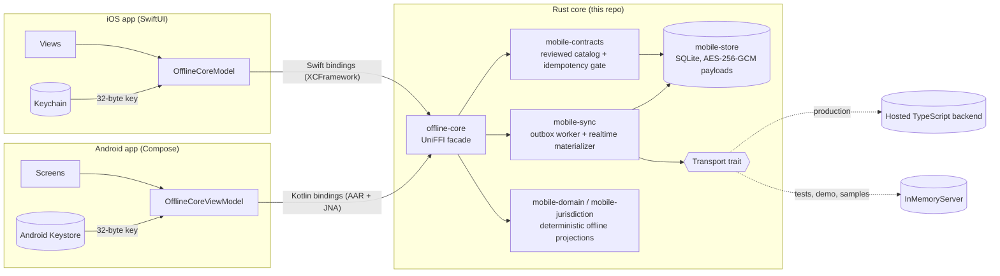
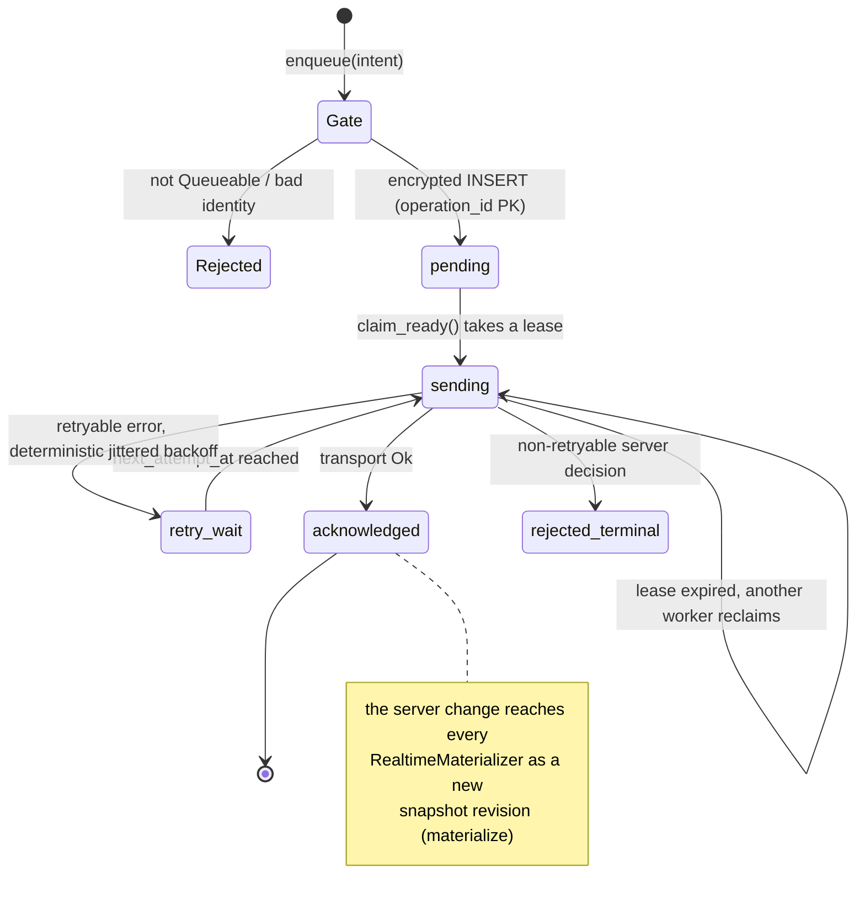

# offline-core

A Rust core that gives native iOS (SwiftUI) and Android (Compose) apps the same offline behavior: an encrypted SQLite store, a leased outbox that refuses writes the server can't deduplicate, and realtime query snapshots that reconnect on their own. Swift and Kotlin get it through UniFFI.

## Why this exists

This was extracted from the native mobile client of a production trucking operations platform. Drivers spend hours out of coverage, but they still change duty status, log fuel, and finish deliveries. Those writes have to survive app kills and flaky networks, and they must land on the server exactly once. The web app and two native apps talked to the same TypeScript backend. Writing the offline logic separately in Swift and in Kotlin would have meant two copies of the hardest code in the product drifting apart. So it lives in Rust once, and each platform shell only provides UI, key storage, and lifecycle events.

## Architecture



| Crate | Responsibility |
| --- | --- |
| `offline-core` | The only crate UniFFI sees. Holds `OfflineCore`, typed intents and snapshots, and maps errors to a stable `SdkError`. |
| `mobile-contracts` | The reviewed catalog of backend functions, each with a kind (query/mutation/action), an offline policy, and an idempotency strategy. |
| `mobile-store` | Versioned SQLite migrations, the leased outbox, encrypted query snapshots, and entity/GPS/device-record caches. |
| `mobile-sync` | `OutboxWorker` (drain, backoff, ack/retry/reject), `RealtimeMaterializer` (subscribe, persist, reconnect), the `Transport` trait, and `mock::InMemoryServer`. |
| `mobile-domain` | FMCSA hours-of-service clocks and route projection, ported from the server's TypeScript engine. |
| `mobile-jurisdiction` | GeoJSON parsing and per-jurisdiction mileage attribution for GPS tracks. |
| `mobile-models` | Small shared types: `OperationId`, `OutboxState`, lifecycle enums. |

### Offline write lifecycle



1. **Enqueue.** `enqueue_*` validates the intent, looks the function up in the catalog, and runs the idempotency gate (below). If the contract names an identity argument, the gate writes the operation UUID into the payload. The payload is encrypted and inserted with `ON CONFLICT(operation_id) DO NOTHING`, so a double-tap in the UI is a no-op too. Nothing touches the network.
2. **Lease.** `OutboxWorker::drain_once(now)` runs `claim_ready` in one transaction. It selects ready rows (due `pending`/`retry_wait` rows, plus `sending` rows whose lease has expired), marks them `sending`, and stamps `lease_owner` and `lease_expires_at`. A background task and a foreground pull can both drain without double-sending. A worker that dies mid-flight loses its lease, and another worker reclaims the row later.
3. **Backoff.** On a retryable error the row goes to `retry_wait` with `next_attempt_at = now + min(base * 2^attempts, max) + jitter`. The jitter is a hash of the operation ID rather than a random number, so tests can assert exact timestamps, and a fleet of devices reconnecting together still spreads out.
4. **Ack.** On `Ok` the row becomes `acknowledged`. A non-retryable error (validation, not found, an authorization decision) becomes `rejected_terminal` and keeps its error code for diagnostics.
5. **Materialize.** The device does not patch its local copy from the write response. Each `RealtimeMaterializer` holds a live query subscription. When server state changes, the complete new result is encrypted and upserted into `query_snapshots` with `revision = revision + 1`. If the stream ends (lost socket, backgrounding), it waits `reconnect_delay_ms` and subscribes again. The UI reads the last durable snapshot by key, so offline reads always show the most recent server-confirmed state, with a revision number.

Two deliberate choices here. Local state is never mutated optimistically from a write. Snapshots only hold what the server confirmed, and pending writes show up as a count (`SdkStatus.undelivered_operations`), not as fake rows. Also, `drain_once` takes `now` as an argument and does one bounded pass with no internal sleeps. The platform decides when to run it (BGTaskScheduler, WorkManager, a pull-to-refresh), and every timing path can be tested without a clock.

### The idempotency gate

Retries are unavoidable offline. The worst case is a write the server committed whose response never arrived. The client sees a timeout and must retry. Whether that retry is safe depends only on the server contract, so every function in `mobile-contracts` declares one:

| Strategy | Meaning | Toy example |
| --- | --- | --- |
| `Intrinsic` | The write assigns state, so repeating it changes nothing. | `tasks:complete` |
| `Argument("clientId")` | One top-level field carries a stable client identity, and the server dedupes on it. The gate injects the operation UUID if the caller left it out. | `tasks:create` |
| `CollectionItem { collection, field }` | Every array item has its own identity. The gate rejects empty arrays and duplicate IDs inside one batch. | `tasks:logTime` |
| `RootAndCollectionItem { .. }` | A root identity plus a per-item sequence, for example device ID plus reading sequence number. | `sensors:ingestReadings` |
| `None` | Not safe to repeat. | `tasks:addComment` |

Only `Queueable` contracts with a strategy other than `None` can enter the outbox. Everything else fails at `enqueue` time with `FunctionNotQueueable` or `InvalidIdempotencyArguments`, before anything is persisted. The alternative is to let the write queue and discover the duplicate in production a week later. Failing at enqueue makes the UI handle it immediately: either require connectivity for that action, or get the backend to accept an idempotency key. That's why `RequiresServerIdempotency` exists as its own policy: it records that mobile wants offline support for the function and that the backend contract is what blocks it. A unit test enforces that no `Queueable` contract is a query or has `IdempotencyStrategy::None`.

The end-to-end test injects exactly this failure. `InMemoryServer::lose_next_acks(1)` applies a create and then reports a transport error. The retry replays it, the server dedupes on `clientId`, and the test asserts one task, `writes_applied == 5`, and `writes_deduplicated == 1`.

### Encryption at rest

- **Key ownership stays on the platform.** The Rust core never generates, stores, or derives the database key. iOS creates 32 random bytes with `SecRandomCopyBytes` and stores them in the Keychain as `AfterFirstUnlockThisDeviceOnly`. Android generates the bytes and wraps them with a non-exportable AES-GCM key in the Android Keystore. Both pass the raw key into `SdkConfig.database_key` at startup. In Rust it is a `DatabaseKey(Zeroizing<[u8; 32]>)` that redacts itself in `Debug` and is zeroed on drop.
- **Payload-level AES-256-GCM.** Each sensitive JSON payload (outbox arguments, cached entities, query snapshot args and results, device records) is stored as `enc:v1:` followed by base64 of `nonce‖ciphertext‖tag`, with a fresh 96-bit random nonce per write.
- **Row binding through AAD.** The associated data is the row's identity, for example `outbox:<operation_id>` or `query_snapshot_result:<key>`. A ciphertext copied into a different row fails authentication instead of decrypting into the wrong context. `encrypts_and_authenticates_payloads` checks this, and `sensitive_payloads_are_ciphertext_on_disk` writes a real file, scans every byte of the database and WAL for a plaintext marker, and confirms that a different key fails to decrypt.
- **Tradeoffs.** This is not SQLCipher. Routing and index columns stay plaintext: function name, entity kind and ID, org ID, outbox state, timestamps, and GPS lat/lng (so pending fixes can be queried in order). That keeps the stock bundled SQLite and lets the outbox index on state and time. The cost is that someone who can read the file sees which operations exist, but not what they contain. Whole-file encryption would be the next step if that metadata becomes sensitive. The `enc:v1:` prefix leaves room to rotate keys or algorithms. Decryption also accepts unprefixed values, which was kept for migrating pre-encryption development databases (see "What was left out").

### Parity with the server-side TypeScript

The backend stays authoritative. The Rust domain code only produces *provisional* projections (`Projection::provisional`, `DataAuthority::LocalProvisional`), so a driver sees HOS clocks and jurisdiction miles while offline. Two mechanisms kept those projections from drifting from the server:

1. **Shared golden fixtures.** `fixtures/hos/*.json` and `fixtures/jurisdiction/*.json` are language-neutral input/expected pairs. In production the TypeScript engine's test suite and these Rust tests ran the *same* files, so a change to either engine that changed results failed CI on both sides. Here only the Rust half ships. The fixtures stand alone as golden tests whose expected values came from the TypeScript implementation. The data is synthetic: `driver-1`, and two unit-square jurisdictions `AA`/`BB`.
2. **Catalog drift test.** `mobile-contracts` parses `contracts/functions.ts`, the TypeScript list of functions the mobile client may call, and asserts it has exactly the same names as the Rust catalog. Adding a function on the TypeScript side without classifying its offline policy in Rust fails `cargo test`. In production this pointed at the real mobile function boundary. This repo carries a six-function toy version so the test still runs.

## Quick start

Requires Rust 1.88+ (edition 2024). Python 3 is optional, for the FFI smoke test.

```bash
git clone <this repo> && cd offline-core

cargo test --workspace                          # 35 tests
cargo run -p mobile-sync --example offline_demo # narrated lifecycle
./scripts/generate-bindings.sh --smoke          # Swift/Kotlin/Python bindings + FFI smoke
```

Demo output (UUIDs and the jittered timestamp differ per run):

```text
== offline: enqueue ==
queued tasks:create  op=2a0f4d6a-…  clientId injected="2a0f4d6a-…"
queued tasks:complete op=13f2c69b-…
gate refused tasks:addComment: backend function is not approved for offline delivery: tasks:addComment

== offline: drain (lease -> fail -> backoff) ==
OutboxRunReport { claimed: 2, acknowledged: 0, retry_scheduled: 2, rejected: 0 }
create is RetryWait, attempt 1, next attempt at t=12294ms

== reconnect with one lost acknowledgement ==
OutboxRunReport { claimed: 2, acknowledged: 1, retry_scheduled: 1, rejected: 0 }
OutboxRunReport { claimed: 1, acknowledged: 1, retry_scheduled: 0, rejected: 0 }
server stats: ServerStats { write_requests: 3, writes_applied: 2, writes_deduplicated: 1, subscriptions_opened: 0 }

== materialize tasks:list ==
RealtimeRunReport { connections: 1, materialized: 1, delivery_errors: 0 }
snapshot revision 1 -> [{"_id":"2a0f4d6a-…","loggedMinutes":0,"orgId":"org-demo","status":"done","title":"Inspect pump"}]
```

### Native bindings and packages

Generated code is never committed. It is rebuilt from the compiled library's UniFFI metadata (proc-macro exports, no UDL).

| Script | Runs on | Produces |
| --- | --- | --- |
| `scripts/generate-bindings.sh [--smoke]` | Linux or macOS | `target/bindings/{swift,kotlin,python}`. `--smoke` loads the real `.so`/`.dylib` from Python and exercises constructors, async methods, typed errors, and the free functions. |
| `scripts/build-ios.sh` | macOS + Xcode 16 | `target/ios/OfflineCorePackage`: a local Swift package wrapping `OfflineCore.xcframework` (device + arm64 simulator), compile-checked with `swift build`. |
| `scripts/build-android.sh` | macOS/Linux + NDK 27, `cargo-ndk`, Gradle | `target/android/OfflineCore.aar` (arm64-v8a + x86_64, with the Kotlin bindings and JNA). |

`samples/ios` (SwiftUI, XcodeGen) and `samples/android` (Compose) are minimal apps built on those packages, with bundle/application ID `com.example.offlinecore`. They run against the core's bundled `InMemoryServer`, so an "Online" toggle simulates connectivity: queue tasks offline, go online, synchronize, and watch the materialized list catch up. Each has its own README.

## Tests

```bash
cargo test --workspace
cargo clippy --workspace --all-targets -- -D warnings   # clippy::pedantic is on
```

What they prove:

- **`offline-core/tests/offline_reconnect.rs`**: the whole loop through the public facade. It starts a realtime query while offline and enqueues five typed writes; the gate refuses a non-idempotent sixth. An offline drain leases all five and backs them off, and nothing is claimable before the window. It then reconnects with one acknowledgement lost, replays, and checks that the server deduplicates. The reconnected materializer must hold server truth (completed task, 45 logged minutes, 3 sensor readings). A write from another client during a second outage appears after reconnect with a higher snapshot revision, and the stale snapshot stays readable while offline.
- **`mobile-store`**: migrations, lease/retry/ack transitions, expired-lease reclaim, gate rejections, identity injection, duplicate-batch rejection, revisioned snapshots, idempotent GPS/device inserts, AES-GCM AAD binding, and a real-file ciphertext-at-rest check.
- **`mobile-sync`**: exact backoff arithmetic, worker ack/retry persistence, query-only materialization, and the mock server's offline errors, deduplication, and stream drop on disconnect.
- **`mobile-contracts`**: catalog invariants plus the TypeScript drift test.
- **`mobile-domain` / `mobile-jurisdiction`**: shared parity fixtures.
- **`offline-core`**: facade lifecycle, key validation, typed intents, typed snapshot decoding.

CI (`.github/workflows/ci.yml`) runs fmt, clippy with `-D warnings`, the tests, the demo, and the binding generation plus FFI smoke test on Ubuntu. The XCFramework and AAR builds need Xcode or the Android NDK, so they are not part of CI.

## What was left out

- The production transport: an adapter from `FunctionTransport`/`RealtimeTransport` onto the hosted backend's Rust client, including auth-token installation.
- The real function catalog (about 90 reviewed backend functions) and its typed driver features: loads, trips, routes, inspections, notifications, and their twelve bootstrap queries.
- Live-state, routing, and observability clients, which were still stubs.
- Release signing and artifact publishing.

`OfflineCore::with_transport` is where a real backend plugs in. Two things kept from the original are worth knowing. `MobileStore` still has GPS and device-record tables from the trucking product, kept as examples of idempotent append queues. The decryptor still accepts unprefixed plaintext rows for development-database migration; a new deployment should remove that fallback.

## License

MIT. See [LICENSE](LICENSE).
